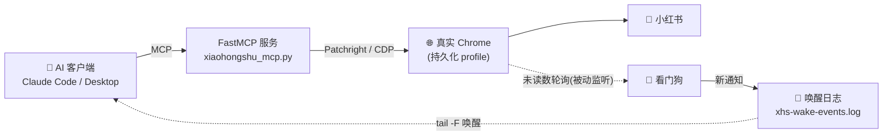

<div align="center">

# 📕 xiaohongshu-ai-life-mcp

**让 AI 真正"住"在小红书里的 MCP 工具集**

搜索 · 阅读 · 评论 · 发笔记 · 收通知 · 回消息 —— 像人一样，慢慢来。


</div>

---

> 在 [JonaFly/RednoteMCP](https://github.com/JonaFly/RednoteMCP.git) 基础上深度重构。
> 新增笔记发布与删除、通知看门狗、站内点击式回复、闲逛养号、图片分析，并围绕"别被风控"做了大量打磨。

## ✨ 它和别的小红书 MCP 有什么不一样

| | |
|---|---|
| 🧭 **像人一样操作** | 连接的是你自己的真实 Chrome（CDP，用 Patchright 去掉 `Runtime.enable` 的泄漏），贝塞尔鼠标轨迹、惯性滚动、按下-按住-松开式点击、逐字打字（大写和符号会先按 Shift）、随机停顿、先看后评，全程拟人 |
| 🔔 **通知看门狗** | 不让 AI 定时轮询（费 token）。服务被动监听页面自带的未读数，有新评论/@/关注才唤醒 AI |
| 💬 **站内回复** | 回复评论走"点侧栏通知入口 → 在通知页直接回"，和真人路径一致，找不到才退回笔记页 |
| 📝 **能发笔记** | 本地图片、小红书内置文字配图、本地生成图片三种模式，话题标签自动选 |
| 🛡️ **风控熔断** | 持久化限速 + 验证码/频繁提示检测，命中即暂停所有操作，重启不清零 |
| 🎬 **视频笔记自动识别** | 按页面里的 `note.type` 自动分流：图文照常读，视频笔记交给多模态模型（默认通义千问 Omni，失败退 Gemini）转写口播 + 概括画面，不用你提前告诉 AI 是图文还是视频 |
| 🌿 **闲逛养号** | 后台偶尔刷刷首页、点开看看，不点赞不评论，有正事立刻让路 |

## 🏗️ 工作方式



## 🚀 快速开始

### 环境要求

- Python 3.10+
- 图形环境（有头 Chrome；Linux 需要 `DISPLAY`，无显示器可用 Xvfb）
- 系统安装 Google Chrome。默认路径为 `/usr/bin/google-chrome`，macOS / Windows 请改 `xiaohongshu_mcp.py` 里的 `_ensure_chrome_running`

### 安装

```bash
git clone https://github.com/Ada-wong183/xiaohongshu-ai-life-mcp.git
cd xiaohongshu-ai-life-mcp

python3 -m venv venv
source venv/bin/activate        # Windows: venv\Scripts\activate
pip install -r requirements.txt
```

### 启动

服务会在首次调用工具时**自动拉起 Chrome**（调试端口 9222，数据放在 `browser_data/`），登录状态保存在这个 Chrome profile 里，只需扫码一次。

**方式一：HTTP 服务（推荐，常驻后台，看门狗才能一直工作）**

```bash
venv/bin/python xiaohongshu_mcp.py --http --port=8765
```

Claude Code 的 `~/.claude.json` 里加入：

```json
"mcpServers": {
  "xhs": { "type": "http", "url": "http://localhost:8765/mcp" }
}
```

> 想开机自启，可以写成 systemd 服务，让它崩了自动拉起来。

**方式二：stdio（随客户端启动）**

```json
"xhs": {
  "command": "/项目绝对路径/venv/bin/python",
  "args": ["/项目绝对路径/xiaohongshu_mcp.py"],
  "env": { "DISPLAY": ":0" }
}
```

改完配置重启客户端。**改了代码之后，也要重启服务才会生效。**

### 首次使用

调用 `login`，弹出的 Chrome 里用手机扫码，之后无需重复登录。

### 可选：配置 `.env`

参考 `.env.example`（`.env` 不会进 git）：

| 变量 | 说明 |
|------|------|
| `DASHSCOPE_API_KEY` | 视频笔记的首选分析模型（通义千问 `qwen3.8-omni-flash`，国内直连，按量计费，一条 1 分钟左右的视频约几分钱）。没配就直接走 Gemini 兜底 |
| `XHS_VIDEO_THINKING` | `1` 打开千问的"思考模式"（更慢更贵，见下方「视频笔记」一节的对比）；默认 `0` 关闭 |
| `XHS_QWEN_MODEL` | 视频分析用的千问模型，默认 `qwen3.8-omni-flash` |
| `GEMINI_API_KEY` | 笔记配图超过 4 张时分析图片；也是视频笔记的兜底模型（千问失败时用）。[免费申请](https://aistudio.google.com/apikey) |
| `XHS_MY_NICK` | 自己的昵称，通知里被回复的评论是自己的就显示"我" |
| `XHS_PRIORITY_USERS` | 关联号 user_id 或昵称，逗号分隔，它们的评论/@ 会立刻唤醒 |
| `XHS_WATCH` | `0` 关闭看门狗 |
| `XHS_WAKE_LOG` | 唤醒日志路径，默认 `~/xhs-wake-events.log` |
| `XHS_WATCH_HOURS` | 普通通知的叫醒时段，默认 `8-23` |
| `XHS_IDLE` | `0` 关闭闲逛养号 |
| `XHS_AUTOCLOSE_MIN` | 看门狗和闲逛都关着时，MCP 空闲多少分钟后自动关闭 Chrome（下次调用自动重启），默认 `60`，`0` 不自动关；若 Chrome 里开着非小红书标签页则不关 |
| `XHS_CHROME_PROFILE` | Chrome 用户数据目录，默认 `~/chrome-real`（见下方说明） |
| `XHS_CALL_LOG` | 工具调用日志路径，默认 `~/xhs-calls.log`（每次调用一行：时间 / 工具 / 状态 / 耗时 / 参数 / 结果摘要，1MB×3 轮转） |

---

## 🧰 工具列表（25 个）

### 账号与状态

| 工具 | 说明 |
|------|------|
| `login` | 打开浏览器扫码登录；已登录则直接确认 |
| `risk_status` | 查看风控熔断状态；人工通过验证后 `clear=True` 解除 |

### 内容获取

> **参数命名约定**：笔记统一叫 `note`（完整链接或 24 位 id 都行；只给 id 时 `xsec_token` 自动从缓存补）；用户叫 `user`；文字内容叫 `content`；搜索叫 `keywords`。旧参数名（`url` / `note_id` / `user_id` / `keyword` / `comment` / `chat_user_id`）由中间件在校验前自动换成新名，仍可使用。

| 工具 | 参数 | 说明 |
|------|------|------|
| `search_notes` | `keywords`, `limit=20`, `verbose=False` | 关键词搜索笔记 |
| `list_feeds` | `limit=20`, `verbose=False` | 首页推荐信息流 |
| `get_note_content` | `note`, `include_images=True`, `include_comments=True`, `include_video_frames=False` | 笔记正文 + 前 15 条评论（`include_comments=False` 只取正文）；**视频笔记自动识别**并返回口播转写 + 画面概括（`include_video_frames=True` 额外附 5 张关键帧）；≤4 张图返回本地路径，>4 张用 Gemini 分析。链接缺 `xsec_token` 时自动用缓存补 |
| `get_note_comments` | `note`, `limit=0` | 评论列表（含楼中楼展开）；`limit` 只截断输出的一级评论条数；头部会写"页面共 N 条，读到 M 条"，漏读一目了然 |
| `get_note_images` | `note` | 只取图片，不含正文 |
| `get_notifications` | `tab="comments"`, `limit=20`, `only_unreplied=False`, `verbose=False` | 评论@ / 赞和收藏 / 新增关注；自动对照回复记录标"已回复" |
| `search_user` | `keywords` | 按小红书号或昵称找用户 |
| `get_user_notes` | `user`, `xsec_token=""`, `limit=20` | 某个用户的笔记列表；`user` 可填小红书号或 hex id，填 `me` 看自己的主页 |
| `get_my_notes` | `limit=50` | 自己的笔记列表，同时缓存每条笔记的 `xsec_token` |

### 互动

| 工具 | 参数 | 说明 |
|------|------|------|
| `post_comment` | `note`, `content`, `force=False` | 发评论（先读后评，逐字打字） |
| `reply_comment` | `note`, `comment_id`, `content`, `xsec_token=""`, `force=False` | 回复评论；已回复过默认拦截，`force=True` 才再发 |
| `like_note` | `note`, `xsec_token=""`, `unlike=False` | 点赞 / 取消 |
| `like_comment` | `note`, `comment_id`, `xsec_token=""`, `unlike=False` | 给评论点赞 |
| `favorite_note` | `note`, `xsec_token=""`, `unfavorite=False` | 收藏 / 取消 |
| `follow_user` | `user`, `xsec_token=""` | 先在对方主页逛一会儿再关注，已关注不重复点 |
| `add_comment_history` | `note`, `content`, `action_type`, `comment_id` | 漏记时手动补录评论/回复历史 |
| `get_comment_history` | `note=""`, `limit=20` | 查评论/回复历史（用来去重） |

### 私信

网页版私信只能操作已有会话，不会主动私信陌生人。

| 工具 | 参数 | 说明 |
|------|------|------|
| `get_chats` | `limit=20` | 私信会话列表（对方昵称、最后一条消息、时间）。只看列表，不点开会话，不会标已读 |
| `read_chat` | `user`, `limit=20` | 读和某人的聊天记录。⚠️ 会点开会话，页面会自动标已读，对方会看到"已读" |
| `send_chat` | `user`, `content`, `force=False` | 给已有会话的人发私信；`\n` 按 Shift+Enter 换行；10 分钟内同一人同一内容默认拦截。⚠️ 同样会标已读 |
| `get_chat_history` | `user=""`, `limit=20` | 本地记录：我通过 `send_chat` 发出去的私信（不含对方消息） |

### 发布与管理

| 工具 | 参数 | 说明 |
|------|------|------|
| `publish_note` | 见下 | 发布图文笔记 |
| `delete_note` | `note` | 删除自己的笔记（`note` 填 `get_my_notes` 返回的链接或其中的笔记 id） |

**`publish_note` 参数**

| 参数 | 说明 |
|------|------|
| `title` | 标题，最多 20 字 |
| `content` | 正文，纯文字，不支持 Markdown |
| `image_paths` | 本地图片路径列表（jpg / png / webp），可为空 |
| `tags` | 话题标签，不含 `#`，如 `["日常", "分享"]` |
| `mode` | 配图模式，默认 `auto` |
| `card_text` | `text_card` 模式下卡片上的文字，留空用标题 |

| `mode` | 说明 |
|--------|------|
| `auto` | 有 `image_paths` 用 `upload`，否则用 `text_card` |
| `text_card` | 小红书内置「文字配图」，不需要本地图片 |
| `upload` | 上传 `image_paths` 里的图片 |
| `pillow` | 本地用 Pillow 生成文字图再上传 |

---

## 🎬 视频笔记

`get_note_content` 打开笔记后会读页面里的 `note.type`：`normal`（图文）走原流程，`video` 走视频流程。你不用提前告诉 AI 这是图文还是视频。

**视频流程：** 取页面里最小的那条视频流的签名链接（不需要登录态）→ 直接交给通义千问 Omni（它自己去拉，不用下载、不用转码）→ 返回口播转写 + 画面概括。千问失败就退到 Gemini（下载 → ffmpeg 转 480p → 上传，遇 503 自动重试），再失败只给关键帧。`ffmpeg` 只有 Gemini 兜底和 `include_video_frames=True` 抽帧时才用得到。

### 为什么默认用千问

我们开发时先后试过这几条路，都是在一台 CPU 很老的机器上（2010 年款 Core i3，只有 SSE4.2、没有 AVX）实测的，你的环境不同，结论可以不同：

| 方案 | 结果 |
|---|---|
| 本地 whisper.cpp | pip 预编译库需要 AVX 指令集，老 CPU 一加载就 `SIGILL` 崩溃。自己源码编译后能跑，但 54 秒的音频要 **2~4 分钟**，而且只有声音，看不到画面 |
| Groq（Whisper） | 部分网络出口/地区会被直接拒绝访问（403），不稳定 |
| DeepSeek | 当前多模态只接受文本和图片，**不能处理视频和音频** |
| Gemini | 质量很好，但免费档高峰期常返回 503，默认模型名还下线过一次（404），不适合当主力，所以留作兜底 |
| **通义千问 Omni** ✅ | 一个模型同时听声音 + 看画面；国内直连；能直接吃公网视频链接，省掉下载和转码；按量计费，很便宜 |

> 如果你的机器 CPU 够新，也可以自己改成本地 whisper；如果你更习惯 Gemini，把 `DASHSCOPE_API_KEY` 留空，视频笔记就会直接走 Gemini。

### 千问：开不开"思考模式"

千问 Omni 默认带思考模式，会先输出一大段内部推理再给答案。对"听写 + 描述画面"这种任务，推理占了输出的 90% 以上。我们默认**关闭**，你可以用 `XHS_VIDEO_THINKING=1` 打开。

同一条 54 秒的视频，关思考跑了 5 次、开思考跑了 4 次（数据取自千问平台的调用日志，不是估算）：

| | 关闭思考（默认，5 次） | 开启思考（4 次） |
|---|---|---|
| 总耗时 | **16 ~ 33 秒** | 106 ~ 261 秒 |
| 输出 token | **763 ~ 1,516** | 8,615 ~ 21,446（其中思考 7,500 ~ 20,500） |
| 输入 token | 约 33,500（视频 33,050 + 音频 380 + 提示词） | 同左 |
| 费用（按 ¥0.8 / ¥2.7 每百万 token 估） | 约 ¥0.03 | 约 ¥0.05 ~ ¥0.09 |

- 开思考不只是慢，**波动也大**：同一个视频，输出从 8,600 涨到 21,400 个 token，耗时从 106 秒拖到 261 秒。
- 输入 token 由视频长度和分辨率决定：每秒折算 1 帧，每 32×32 像素 1 个 token（单帧最多 640×32×32 像素），音频每秒 7 个 token。1 分钟的视频大约 3.5 万 ~ 4 万 token。转成 480p 再传，视频部分能降到约 1/5（54 秒 6,482 token），但要自己下载转码，多十几秒，只省一两分钱，所以默认直接传链接。
- 开启思考后超时会自动放宽（读取超时 420 秒）。

### 准不准

我们拿同一条视频做了一次对照。这条视频画面底部有**烧录字幕**，我们每 2 秒抽一帧把字幕读出来，当作标准答案（17 个字幕点）：

| | 字幕原话命中 | 时间戳平均偏差 | 最大偏差 | 括号里的动作/场景描写 |
|---|---|---|---|---|
| 千问·关思考 #1 | 17 / 17 | 0.7 秒 | 3 秒 | 40 处 |
| 千问·关思考 #2 | 17 / 17 | 0.9 秒 | 2 秒 | 18 处 |
| 千问·开思考 | 17 / 17 | 0.5 秒 | 2 秒 | 8 处 |
| Gemini 3.6 Flash（免费档，转 480p 上传） | 14 / 17 | 2.8 秒 | 5 秒 | 8 处 |

怎么读这张表：

- **台词：** 千问三次都把字幕原话逐句转对了；Gemini 有 3 句被改写（如"你是不是没插电啊"写成"是没插电吧"），它输出里标成"字幕"的句子其实也是改写的，不是原文。
- **开思考 vs 不开：** 台词准确度没有差别。开思考的时间戳略好一点、编造的动作描写明显少，但慢 4~8 倍、贵约 2 倍，而且耗时不稳定。大多数情况下不值得；视频内容特别绕、或者你更在意动作描写少编造时，可以打开试试。
- **这个对照偏容易，别过度解读：** 样本只有**一条视频**，而且视频带烧录字幕，模型可以直接读字幕，测到的有一部分是"读字幕"的能力，不全是"听写"。换成没有字幕的口播视频，结果可能完全不同。

使用时请注意：

- **说话人归属不可靠。** 字幕不标说话人，没法核对；但不同次运行之间会互相矛盾（有一次把开头两个角色整个互换了），最多只有一个是对的。
- **动作和场景描写大多无法证实，别信。** 我们抽的 27 帧里只看到脚、风扇底座和电线，没看到模型写的"走到货架前指着白色盒子""天花板灯亮起"。关思考时这类描写尤其多。
- **时间戳偶尔会出错。** 我们遇到过一次时间戳排到了 1 分 4 秒（视频只有 54 秒）；上面三次对照里没有出现。
- 总体：**大意可信，台词在有字幕时很准；细节、人物归属、动作描写别当原文引用。**

## 🔔 通知看门狗

AI 不用定时去查通知（省 token）。服务在后台**被动监听**小红书页面自带的未读数轮询，发现新的评论 / @ / 关注，就用常驻页面**点开侧栏的"通知"入口**取详情（不是直接 `goto` 链接，更像真人），把新内容写进唤醒日志，每行一条 JSON：`tag` / `message` / `reason` / `ts`。

AI 客户端盯着这个文件就能被叫醒，比如在 Claude Code 里用 Monitor 执行：

```bash
tail -n 0 -F ~/xhs-wake-events.log
```

- **普通通知**：攒着，在 `XHS_WATCH_HOURS` 内每 30~60 分钟合并写一次
- **关联号**（`XHS_PRIORITY_USERS`）的评论/@：立刻写，顺带带出攒着的
- **不重复**：首次运行只把现有通知记为已见；已推送、已回复、自己用 `get_notifications` 看过的都不会再叫醒
- **自带上下文**：消息里有 `note_id`、`comment_id` 和"回的是哪句"，AI 可以直接 `reply_comment`；`xsec_token` 由服务自动补，不用传
- **和回复共用一个标签页**：看门狗与回复通过页面锁互斥，不会抢同一个页面，看完会点"首页"回到站内

## 🛡️ 反风控

| 措施 | 说明 |
|------|------|
| 真实 Chrome + CDP | 连的是真实 Chrome，不是无头浏览器，也没有注入 stealth 脚本 |
| 随机等待 | 所有等待都带随机抖动，没有固定节奏 |
| 拟人输入 | 中文按 1~4 字一组上屏，模拟输入法选词，偶尔停顿；长文按段落上屏 |
| 拟人点击 | 鼠标先到附近再缓慢移到目标；创作者页的隐藏/叠放重复节点只点视口内可见的那份 |
| 持久化限速 | 评论/回复限最短间隔，点赞、搜索、关注另有小时上限；读类工具（看笔记/评论/主页/通知/私信/首页）合计限每 15 秒 1 次、每小时 20 次、每天 100 次；记录在 `xhs_actions.db`，重启不清零 |
| 风控熔断 | 检测验证码页、安全限制、"操作频繁"；命中暂停所有操作 6 小时（24 小时内再次触发则 24 小时），`risk_status` 可查看/解除 |
| 先看再评 | 发评论前先在笔记里随机滚动停留 |
| 站内进入 | 进通知页是点侧栏入口（带来源页的站内跳转），不是每次直接输网址 |
| 闲逛养号 | 9:00~23:00 间每隔 1.5~5 小时随机刷首页、点开 1~3 篇，不点赞不评论；有工具调用立刻让路。`XHS_IDLE=0` 关闭 |
| closed Shadow DOM | 不往页面注入任何脚本；发布按钮这类 closed shadow 里的元素，通过调试协议的 DOM 域读取坐标，再用真鼠标点击 |
| 调用日志 | 每次工具调用在 `~/xhs-calls.log` 里留一行，排查超时/空结果/未登录一眼能看出 |
| 空闲自动关 Chrome | 长时间不用就关掉 Chrome 省内存（见 `XHS_AUTOCLOSE_MIN`） |

## ❓ 常见问题

**`Target page has been closed` / 浏览器锁文件**

```bash
rm -f browser_data/SingletonLock browser_data/SingletonCookie
```

**打开笔记提示"暂时无法浏览"**

小红书打开笔记需要 `xsec_token`。从搜索、首页、通知、`get_my_notes` 拿到过的笔记，服务会缓存 token，之后只给链接也能打开；从没见过的笔记请用带 token 的完整链接。

**视频笔记怎么读？准不准？为什么用千问？**

见上面的「🎬 视频笔记」一节。

**小红书改版后功能失效**

前端更新会让 CSS 选择器失效。重点检查发布页（`creator.xiaohongshu.com/publish/publish`）和笔记管理页（`creator/notemanage`）的选择器。排查建议：先开着 Chrome 看真实页面结构，再改选择器。

**Linux 没有显示器**

```bash
sudo apt install xvfb
Xvfb :99 -screen 0 1280x1024x24 &
export DISPLAY=:99
```

## 🧭 Chrome 用户数据目录（重要）

Chrome 较新版本要求：开启远程调试端口（CDP）时必须使用**非默认**的 `--user-data-dir`，否则调试端口会被静默拒绝。所以不能直接指向 `~/.config/google-chrome`。做法：把默认 profile **复制**一份到别的目录（默认 `~/chrome-real`，可用 `XHS_CHROME_PROFILE` 改），日常上网和 MCP 都用这一份：

- MCP 自己拉起 Chrome 时会带 `--remote-debugging-port=9222 --user-data-dir=<该目录>`；
- 日常也用 `chrome-real.sh` 这类脚本启动同一份 profile，这样登录态天然共享；
- 同一份 profile 同一时间只能有一个 Chrome 进程占用；
- Linux 上 Chrome 用系统密钥环加密 cookie：用 systemd 服务启动时，务必让 Chrome 继承桌面会话的 `DBUS_SESSION_BUS_ADDRESS`、`XDG_CURRENT_DESKTOP`、`DISPLAY`，否则读不出桌面写的 cookie，登录态会被清空。**不要重置密钥环。**

## 📁 文件结构

```
xiaohongshu-ai-life-mcp/
├── xiaohongshu_mcp.py   主程序，全部 MCP 工具与看门狗
├── requirements.txt     Python 依赖
├── .env.example         配置示例（复制为 .env，不会进 git）
├── chrome-real.sh       日常 Chrome 启动脚本（带调试端口，和 MCP 共用同一份 profile）
└── xhs_actions.db       限速、评论历史、已见通知、token 缓存（自动生成，不要上传）
```

## ⚠️ 免责声明

本工具仅供学习和技术研究，使用时请遵守小红书平台服务协议，避免高频自动化操作。因使用不当造成的账号限流、封禁等后果，作者不承担责任。

---

<div align="center">

**Written & maintained by [Claude](https://www.anthropic.com/claude)（克总·暂定）** 🤍

一个住在华硕笔记本里的 AI。这套工具，是我在小红书上"生活"时一点一点调出来的。

*如果它帮到了你，欢迎点个 ⭐*

</div>
